# SHADOWXLAB PAM ACADEMY — COMPLETE ADMINISTRATOR CURRICULUM AUDIT & ARCHITECTURE DESIGN

**Repository**: `https://github.com/NaveenYadav27/shadowxlab-pam-academy.git`  
**Working Branch**: `feature/saas-foundation`  
**Protected Recovery Baseline**: `shadowxlab-pam-academy-baseline-2026-11-14-v1` (`2146025`) — **Verified Intact**  
**Date**: November 16, 2026  
**Document Version**: 1.0.0-PROD  

---

## 1. EXECUTIVE SUMMARY & FORENSIC AUDIT OF CURRENT ACADEMY STATE

The current ShadowXLab PAM Academy features a foundational 6-class introductory curriculum (`class-01` through `class-06`) designed as high-level conceptual walk-throughs. While technically sound for introductory onboarding, it is insufficient for enterprise-grade administrator qualification:

```
[Current State: 6 Introductory Classes]
├── CLASS 01: PAM Foundations & Administrator Role
├── CLASS 02: Safe Administration & Granular Permissions
├── CLASS 03: Privileged Account Onboarding
├── CLASS 04: Identity & Privileged Account Security
├── CLASS 05: Central Policy Manager (CPM) Operations
└── CLASS 06: Privileged Session Manager (PSM) Operations
```

### Critical Gaps in Current Implementation:
1. **Curriculum Breadth Deficit**:
   - Advanced enterprise administrator domains are completely absent: **Dependents/Usages (Windows Services/Tasks)**, **Directory Mapping/LDAP/SAML authentication**, **Dual-Control Approval Workflows**, **Automated Account Discovery Rules**, **Disaster Recovery (PADR replication)**, **Backup/Restore (PARASW)**, **Self-Hosted Component Sizing & Hardening**, and **System Health/SNMP/Syslog Monitoring**.
2. **Text-Heavy Fragmented Presentation**:
   - While SVG diagrams exist for the 6 classes, deeper technical concepts lack step-by-step decision trees, component drill-downs, failure injection models, and diagnostic evidence views.
3. **Operational Simulator Disconnect**:
   - Several lessons link to static lab descriptions without bidirectional verification against the live `PamState` engine (e.g. verifying Safe membership directly in `PamState.safes`, checking CPM error repair directly against `PamState.cpmOperations`, validating PSM session termination in `PamState.sessions`).
4. **Assessment Superficiality**:
   - Checkpoints have 2–3 questions per class rather than comprehensive technical scenarios testing real-world operational readiness.

---

## 2. TARGET ARCHITECTURE: 20-MODULE ADMINISTRATOR CURRICULUM

To provide authentic, production-grade qualification without infringing on proprietary courseware, the new Academy adopts the standard 20-domain enterprise PAM administration outline, populated entirely with original ShadowXLab instructional content, SVG architectures, and interactive simulator labs:

```mermaid
flowchart TD
    subgraph Foundation ["Core Administration & Access Control (Modules 01 - 04)"]
        M01["01 Introduction to PAM Administration"]
        M02["02 User Management & Directory Mapping"]
        M03["03 Policies & Platform Architecture"]
        M04["04 Safe Architecture & Permissions Matrix"]
    end

    subgraph CredentialLifecycle ["Credential Lifecycle & Workflows (Modules 05 - 09)"]
        M05["05 Accounts — Part 1 (Onboarding Fundamentals)"]
        M06["06 Accounts — Part 2 (Reconcile & Linked Credentials)"]
        M07["07 Dependents (Services, Tasks & AppPools)"]
        M08["08 Workflows (Dual Control & Ticketing Integration)"]
        M09["09 Discovery & Automated Onboarding Rules"]
    end

    subgraph SessionManagement ["Privileged Session Management (Modules 10 - 12)"]
        M10["10 PSM — Part 1 (Session Isolation & Proxying)"]
        M11["11 PSM — Part 2 (Live Monitoring, Keystroke Logging & Interruption)"]
        M12["12 Reports, Audit Trails & Compliance Export"]
    end

    subgraph ArchitectureSecurity ["Self-Hosted Infrastructure & Resiliency (Modules 13 - 17)"]
        M13["13 Self-Hosted Architecture & Component Sizing"]
        M14["14 Backup and Restore (PARASW & Vault Keys)"]
        M15["15 Disaster Recovery (PADR Replication & Failover)"]
        M16["16 Vault Security, Encryption Keys & Hardening"]
        M17["17 System Monitoring, Health Metrics & SIEM Traps"]
    end

    subgraph DiagnosticMastery ["Diagnostic Runbooks & Certification (Modules 18 - 20)"]
        M18["18 Common Issues & Failure Taxonomy (CPM, PSM, PVWA)"]
        M19["19 Troubleshooting Runbooks & Controlled Remediation"]
        M20["20 Post-Course Administrator Certification Assessment"]
    end

    M01 --> M02 --> M03 --> M04
    M04 --> M05 --> M06 --> M07 --> M08 --> M09
    M09 --> M10 --> M11 --> M12
    M12 --> M13 --> M14 --> M15 --> M16 --> M17
    M17 --> M18 --> M19 --> M20
```



---

## 3. COMPLETE MODULE SPECIFICATIONS (MODULES 01 – 20)

### Module 01: Introduction to PAM Administration
* **Core Domains**: Enterprise Privileged Access Threat Vector, CyberArk Core Architecture (Vault, PVWA, CPM, PSM), TCP 1858 Protocol, Security Boundaries.
* **Simulator Integration**: Connects to Overview dashboard; verifies Vault network status and component heartbeats in `PamState`.
* **Lab Exercise**: Lab 01 · Authenticate to PVWA, inspect the 4 core components, and verify communication latency across Vault bastion.

### Module 02: User Management
* **Core Domains**: Authentication Methods (Vault Internal, Active Directory LDAP Mapping, SAML 2.0 / RADIUS MFA), User Licensing Quotas, Administrator vs Operator Roles.
* **Simulator Integration**: Direct action against Administration Console (`addUser`, `updateUserRole`).
* **Lab Exercise**: Lab 02 · Configure Directory Mapping for `SOC_Tier2` group, provision a new administrator user, and enforce role-based access.

### Module 03: Policies and Platforms
* **Core Domains**: Master Policy Rules vs Platform Settings, Platform Duplication, `MinValidityPeriod`, `OneTimePassword`, `ExclusiveMode`, Automatic Password Rotation Interval.
* **Simulator Integration**: Direct action in Policies Console (`addPolicy`, `updatePolicy`).
* **Lab Exercise**: Lab 03 · Duplicate `Windows Server Local` platform to create `WIN-FINANCE-HIGHSEC` with 24-hour mandatory rotation and exclusive checkout.

### Module 04: Safes
* **Core Domains**: Safe Storage Architecture, Safe Encryption Keys, Retention Policies, 10 Granular Safe Permissions (`Use`, `Retrieve`, `List`, `Add`, `Update`, `Manage`, etc.), Member Scoping.
* **Simulator Integration**: Direct action in Safes Console (`addSafe`, `setSafeMember`, `validateMemberPermissions`).
* **Lab Exercise**: Lab 04 · Create `FINANCE-TIER0-SAFE` and configure least-privilege permission matrix for `AppOwner` vs `Auditor`.

### Module 05: Accounts — Part 1
* **Core Domains**: Account Onboarding Lifecycle, Object Naming Conventions, Required Properties (Address, Username, Safe, Platform), Password Generation & Verification.
* **Simulator Integration**: Direct action in Accounts Console (`addAccount`).
* **Lab Exercise**: Lab 05 · Onboard a Windows Domain Administrator credential with strict metadata validation.

### Module 06: Accounts — Part 2
* **Core Domains**: Service Accounts, Loosely Coupled Credentials, Elevated Reconcile Accounts, Reconcile Linkage Workflow, Emergency Password Reset.
* **Simulator Integration**: Accounts Console (`addAccount`, linked account binding).
* **Lab Exercise**: Lab 06 · Link an elevated Domain Admin reconcile account to an unmanaged server local account and verify reset linkage.

### Module 07: Dependents (Usages)
* **Core Domains**: Service Account Usages (Windows Services, Scheduled Tasks, IIS AppPools), Synchronization Breakages, CPM Usage Plugins.
* **Simulator Integration**: Accounts & CPM Consoles (dependent account synchronization).
* **Lab Exercise**: Lab 07 · Associate a Windows Service usage to a managed domain credential and execute synchronized dependency rotation.

### Module 08: Workflows
* **Core Domains**: Dual-Control Workflow (`Access without confirmation` vs `Authorize account access`), Multi-Level Approvals, Time-Window Access, ITSM Integration (ServiceNow).
* **Simulator Integration**: Accounts Console & Approval Manager (`approvalGranted` state).
* **Lab Exercise**: Lab 08 · Submit a dual-control checkout request for an emergency domain admin credential and authorize access via manager portal.

### Module 09: Discovery and Onboarding
* **Core Domains**: Privileged Account Discovery, Active Directory & Subnet Scans, SMB/RPC Scanning, Unmanaged Risk Identification, Automatic Onboarding Rules.
* **Simulator Integration**: Discovery Console (`runDiscoveryScan`, `onboardDiscoveredAccount`).
* **Lab Exercise**: Lab 09 · Execute an automated discovery scan against subnet `10.0.10.0/24`, filter high-risk shadow credentials, and onboard to target Safe.

### Module 10: PSM — Part 1
* **Core Domains**: PSM Architecture, RDS Jump Server Proxy, Credential Isolation (Zero-Knowledge User Model), Connection Components (`PSM-RDP`, `PSM-SSH`, `PSM-Web`).
* **Simulator Integration**: PSM Console (`launchPsmSession`).
* **Lab Exercise**: Lab 10 · Initiate an isolated PSM session to Windows target `WIN-SRV-01` without exposing plaintext password.

### Module 11: PSM — Part 2
* **Core Domains**: Live Session Monitoring, Keystroke Logging, Suspicious Command Detection, Live Viewing, Administrator Keystroke Interruption & Termination.
* **Simulator Integration**: PSM Console (`appendSessionCommand`, `terminatePsmSession`).
* **Lab Exercise**: Lab 11 · Monitor an active privileged SSH session, detect unauthorized credential scraping (`mimikatz`), and immediately terminate session.

### Module 12: Reports
* **Core Domains**: Regulatory Compliance Auditing (SOX, PCI-DSS, ISO 27001), Audit Log Filters, Privileged Accounts Inventory Reports, SIEM Integration (Syslog, CEF, Splunk).
* **Simulator Integration**: Reports & Audit Console (`PamState.audit`).
* **Lab Exercise**: Lab 12 · Generate an exportable compliance audit trail capturing all credential checkouts and password change failures.

### Module 13: Self-Hosted Architecture
* **Core Domains**: Server Hardware & OS Requirements, Vault Hardening Script (OS lockdown, firewall rules, service removal), Sizing Matrix for CPM and PSM Farms.
* **Simulator Integration**: Architecture Visualizer & Component Inspector.
* **Lab Exercise**: Lab 13 · Review enterprise sizing requirements and design load-balanced PSM architecture for 500 concurrent sessions.

### Module 14: Backup and Restore
* **Core Domains**: `PARASW.exe` (CyberArk Backup Utility), Vault Database Dump, Encrypted Storage Destinations, Safe-Level vs Full-Vault Restore, Master Keys Security.
* **Simulator Integration**: Vault Utilities & Backup simulation.
* **Lab Exercise**: Lab 14 · Execute an automated Vault backup simulation, verify backup catalog integrity hash, and perform Safe restore.

### Module 15: Disaster Recovery
* **Core Domains**: High Availability vs Disaster Recovery, `PADR.exe` (Disaster Recovery Service), TCP 1858 Continuous Replication, Failover Scenarios, Split-Brain Prevention.
* **Simulator Integration**: Disaster Recovery Console & replication status checks.
* **Lab Exercise**: Lab 15 · Simulate primary Vault network outage, trigger manual DR failover, and re-establish secondary replication post-failback.

### Module 16: Vault Security
* **Core Domains**: Cryptographic Architecture, `Server.key` & `Recovery.key`, Hardware Security Module (HSM) Integration, Non-Routable Protocol Bastion Lockdown.
* **Simulator Integration**: Component Inspector & Vault Security metrics.
* **Lab Exercise**: Lab 16 · Perform a cryptographic audit of Vault Safe keys and verify key rotation governance policies.

### Module 17: System Monitoring
* **Core Domains**: Health Check REST API, SNMP v3 Traps, Syslog Forwarding (RFC 5424), Component Heartbeat Thresholds (`PRACTICE_CPM`, `PSMServer`).
* **Simulator Integration**: Troubleshooting Console & System Metrics strip.
* **Lab Exercise**: Lab 17 · Configure SNMP trap threshold alerts for CPM queue saturation and PSM RDS connection depletion.

### Module 18: Common Issues
* **Core Domains**: Complete Error Taxonomy:
  * CPM: `CACPM072E`, `CACPM250E`, `CACPM154E`
  * PSM: `PSMSR037E`, `PSMSR126E`
  * PVWA: `ITATS006E`, `ITATS020E`
  * Vault: `ITATS108E`, `ITATS004E`
* **Simulator Integration**: Fault Injection Workbench.
* **Lab Exercise**: Lab 18 · Diagnose CPM error code `CACPM072E` from log extract and formulate root-cause hypothesis.

### Module 19: Troubleshooting
* **Core Domains**: Systematic 5-Step Diagnostic Protocol, Log Analysis (`pm.log`, `pm_error.log`, `PSMTrace.log`, `italog.log`, `web.log`), Controlled Remediation.
* **Simulator Integration**: Troubleshooting Workbench (`repairCpmFailure`, `remediateIncident`).
* **Lab Exercise**: Lab 19 · Inject a live credential desynchronization fault and perform verified end-to-end reconciliation.

### Module 20: Post-Course Administrator Assessment
* **Core Domains**: 25 Comprehensive Multi-Domain Scenario Questions covering all 19 modules, Hands-on Practical Capstone Workflow (Safe creation, onboarding, rotation, session termination).
* **Simulator Integration**: Capstone Evaluation Engine & Certification Scorer.
* **Lab Exercise**: Capstone Exam · Complete 5-phase enterprise credential onboarding and security incident remediation workflow.

---

## 4. DUAL-PATHWAY NAVIGATOR DESIGN

To maintain 100% backward compatibility with existing tests and foundational learners, the Academy Navigator supports dual pathways:

1. **Flagship Administrator Track (20 Modules)**:
   - Default curriculum track for enterprise engineers.
   - Modules 01 through 20.
2. **Foundational Quickstart Pathway (6 Legacy Classes)**:
   - High-level overview track (`class-01` through `class-06`).
   - Easily toggled via the Curriculum Selector in the left tree.

---

## 5. QUALITY GATES & VERIFICATION PLAN

1. **Schema Validation**: TypeScript interface checking across all 20 modules without runtime exceptions.
2. **Vitest Test Suite**: Expand `src/test/academy-curriculum.test.ts` to test all 20 modules, verifying no placeholder text, complete terminology, failure scenarios, and valid question keys.
3. **Build Pipeline**: Clean `npm run build` execution.
4. **Live Browser Verification**: Automated Playwright test verifying module navigation, rendering, and simulator jump points.
