# SHADOWXLAB PAM ACADEMY — 20-MODULE ADMINISTRATOR CURRICULUM RECONSTRUCTION REPORT

**Platform**: [ShadowXLab PAM Academy](https://cyberark.shadowxlab.com/)  
**Repository**: `https://github.com/NaveenYadav27/shadowxlab-pam-academy.git`  
**Production Commit**: `dce031b` (Merged into `main` and `feature/saas-foundation`)  
**Protected Recovery Baseline**: `shadowxlab-pam-academy-baseline-2026-11-14-v1` (`2146025` — **Verified Untouched & Intact**)  
**Verification Date**: November 16, 2026  
**Document Version**: 2.0.0-PROD  

---

## 1. EXECUTIVE SUMMARY & CURRICULUM MISSION

The reconstruction of the ShadowXLab PAM Academy from a shallow six-class introductory prototype into an enterprise-grade **20-Module Privileged Access Management Administrator Curriculum** is complete.

The new curriculum uses the published CyberArk PAM Administration curriculum domains as an architectural reference while delivering original ShadowXLab instructional explanations, SVG architecture diagrams, failure taxonomies, interactive diagnostic evidence, and live operational simulator bindings.

```mermaid
flowchart TD
    subgraph Cat1 ["1. Core Administration & Access Control (Modules 01–04)"]
        M01["01 Introduction to PAM Administration"]
        M02["02 User Management & Directory Mapping"]
        M03["03 Policies & Target Platform Governance"]
        M04["04 Safe Architecture & Granular Permissions Matrix"]
    end

    subgraph Cat2 ["2. Credential Lifecycle & Workflows (Modules 05–09)"]
        M05["05 Accounts — Part 1 (Onboarding & Validation)"]
        M06["06 Accounts — Part 2 (Reconcile & Linked Credentials)"]
        M07["07 Dependents (Services, Tasks & AppPools)"]
        M08["08 Workflows (Dual Control & Ticket Integration)"]
        M09["09 Discovery & Automated Onboarding Rules"]
    end

    subgraph Cat3 ["3. Privileged Session Management & Governance (Modules 10–12)"]
        M10["10 PSM — Part 1 (Session Isolation & Injection)"]
        M11["11 PSM — Part 2 (Live Monitoring & Forced Termination)"]
        M12["12 Reports, Audit Trails & Compliance Export"]
    end

    subgraph Cat4 ["4. Self-Hosted Infrastructure & Hardening (Modules 13–17)"]
        M13["13 Self-Hosted Architecture & Sizing"]
        M14["14 Backup and Restore (PARASW & Granular Safe Recovery)"]
        M15["15 Disaster Recovery (PADR Replication & Failover)"]
        M16["16 Vault Security, Envelope Encryption & HSM"]
        M17["17 System Monitoring, Health Telemetry & SNMP Traps"]
    end

    subgraph Cat5 ["5. Diagnostic Mastery & Certification (Modules 18–20)"]
        M18["18 Common Issues & Subsystem Error Taxonomy"]
        M19["19 Systematic Troubleshooting & Log Forensics"]
        M20["20 Post-Course Administrator Certification Exam"]
    end

    M01 --> M02 --> M03 --> M04
    M04 --> M05 --> M06 --> M07 --> M08 --> M09
    M09 --> M10 --> M11 --> M12
    M12 --> M13 --> M14 --> M15 --> M16 --> M17
    M17 --> M18 --> M19 --> M20
```



---

## 2. THE 20 ADMINISTRATOR MODULE SPECIFICATIONS

| Module | Title | Difficulty | Core Architectural & Operational Focus | Target Console |
| :--- | :--- | :--- | :--- | :--- |
| **01** | **Introduction to PAM Administration** | Foundational | Zero-trust bastion model, 4 subsystems (Vault, PVWA, CPM, PSM), proprietary TCP 1858 protocol, non-routable OS isolation. | Overview |
| **02** | **User Management** | Associate | Active Directory/LDAP Directory Mapping, SAML 2.0 / RADIUS MFA, user licensing quotas, role separation (Admin vs Auditor vs Operator). | Access |
| **03** | **Policies and Platforms** | Professional | Master Policy baseline rules vs Platform overrides, platform cloning, `PerformPeriodicChange`, `MinValidityPeriod`, Exclusive Checkout, One-Time Passwords (OTP). | Policies |
| **04** | **Safes** | Professional | Safe cryptographic compartments, 30/90-day retention policies, 10+ granular Safe permissions (`Use` vs `Retrieve`, `Manage`, `List`), CPM membership requirements. | Safes |
| **05** | **Accounts — Part 1** | Associate | Account object schema (Safe, Platform, Address, Username, Secret), FQDN naming conventions, pre-management Verify gates, duplicate prevention. | Accounts |
| **06** | **Accounts — Part 2** | Professional | Elevated Reconcile Accounts, Logon Accounts (`PermitRootLogin no`), out-of-sync credential desynchronization recovery, sudoers configuration. | CPM |
| **07** | **Dependents (Usages)** | Professional | Non-human service identities, Windows Services (SCM), Scheduled Tasks, IIS Application Pools, atomic password propagation, Error 1069 prevention. | Accounts |
| **08** | **Workflows** | Associate | Dual-Control (Four-Eyes Principle), `Access without confirmation` vs `Authorize account access`, time-windowed grants, ServiceNow ticket validation. | PSM |
| **09** | **Discovery and Onboarding** | Professional | Automated discovery scanner, AD domain sweeps, SMB/RPC subnet scanning (`10.0.10.0/24`), shadow account triage, Auto-Onboarding Rule regex engine. | Discovery |
| **10** | **PSM — Part 1** | Professional | Remote Desktop Services (RDS) jump host proxy, zero-knowledge credential injection, AppLocker hardening, Connection Components (PSM-RDP, PSM-SSH). | PSM |
| **11** | **PSM — Part 2** | Professional | Live monitoring, dual optical video / text keystroke streams, suspicious command detection (Mimikatz, Wireshark), live viewing, forced session termination. | PSM |
| **12** | **Reports** | Associate | Compliance auditing (SOX 404, PCI-DSS, ISO 27001), Privileged Accounts Inventory, real-time Syslog / Common Event Format (CEF) forwarding to Splunk. | Audit |
| **13** | **Self-Hosted Architecture** | Professional | Infrastructure sizing formulas, automated Vault OS Hardening Script (disabling 70+ services), drop-silent firewall, load-balanced PVWA/PSM farms. | Overview |
| **14** | **Backup and Restore** | Professional | Native backup utility (PARASW.exe), encrypted backup repositories, Master/Recovery key escrow, granular Safe-level restore without system downtime. | Audit |
| **15** | **Disaster Recovery** | Professional | CyberArk DR service (PADR.exe), continuous replication on TCP 1858, manual vs auto-failover, split-brain condition defense, post-recovery failback. | Overview |
| **16** | **Vault Security** | Advanced | Multi-layer AES-256 envelope encryption, key hierarchy (`Recovery.key` -> `Server.key` -> Safe Keys), FIPS 140-2 Level 3 HSM integration, M-of-N key custody. | Overview |
| **17** | **System Monitoring** | Associate | Component heartbeats, SNMP v3 encrypted traps (AuthPriv), Health Check REST API (`/PasswordVault/api/health`), CPM queue saturation, proactive SRE alerting. | Troubleshooting |
| **18** | **Common Issues** | Professional | Complete failure taxonomy: CPM (`CACPM072E`, `CACPM250E`, `CACPM154E`), PSM (`PSMSR037E`, `PSMSR126E`), PVWA (`ITATS006E`), Vault (`ITATS108E`, `ITATS004E`). | Troubleshooting |
| **19** | **Troubleshooting** | Professional | 5-Step Systematic Diagnostic Protocol (Scope -> Correlate -> Hypothesize -> Remediate -> Verify), log forensics (`pm.log`, `PSMTrace.log`, `italog.log`), CreateCredFile.exe. | Troubleshooting |
| **20** | **Post-Course Assessment** | Advanced | Capstone qualification: 25 comprehensive scenario-based questions covering Modules 01–19 + end-to-end operational simulator capstone verification workflow. | Assessments |

---

## 3. DUAL-PATHWAY ARCHITECTURE & BACKWARD COMPATIBILITY

To satisfy enterprise qualification requirements while maintaining 100% backward compatibility for existing learners and test suites, the Academy features a **Dual-Pathway Navigator**:

```
Curriculum Navigator
├── 🛡️ Administrator Track (20 Modules) [Default Enterprise Track]
│    ├── Category 1: Core Administration & Access Control (Modules 01 - 04)
│    ├── Category 2: Credential Lifecycle & Workflows (Modules 05 - 09)
│    ├── Category 3: Privileged Session Management & Governance (Modules 10 - 12)
│    ├── Category 4: Self-Hosted Infrastructure & Hardening (Modules 13 - 17)
│    └── Category 5: Diagnostic Mastery & Certification (Modules 18 - 20)
└── 📖 Foundational Track (6 Classes) [Legacy Introductory Pathway]
     ├── CLASS 01: PAM Foundations & Administrator Role
     ├── CLASS 02: Safe Administration & Access Management
     ├── CLASS 03: Privileged Account Onboarding
     ├── CLASS 04: Identity & Privileged Account Security
     ├── CLASS 05: CPM Operations & Password Management
     └── CLASS 06: PSM Operations & Session Management
```

- **Track Switcher**: One-click toggle in [`src/components/academy/lesson-tree.tsx`](file:///c:/Users/navee/OneDrive/Desktop/SXL-Main/SXL-SOC%20LAB/SXL-SOC%20Analyst/shadowxlab-pam-academy/src/components/academy/lesson-tree.tsx) seamlessly updates the selector dropdown and module tree.
- **Unified Registry**: [`src/lib/academy/content/index.ts`](file:///c:/Users/navee/OneDrive/Desktop/SXL-Main/SXL-SOC%20LAB/SXL-SOC%20Analyst/shadowxlab-pam-academy/src/lib/academy/content/index.ts) exports `ADMIN_MODULES_20`, `ACADEMY_CLASSES_V2`, and `ALL_CURRICULUM_ITEMS` (26 total curriculum units), allowing helper functions (`findClassById`, `findLessonAnywhere`) to resolve any lesson across either track.

---

## 4. VERIFICATION & QUALITY GATES

### Vitest Test Suite Results
All 54 tests across all test suites pass with 100% success rate:
- `src/test/pam-workflows.test.ts`: **35 passed**
- `src/test/academy-curriculum.test.ts`: **15 passed**
- `src/test/learner-journey-e2e.test.ts`: **3 passed**
- `src/test/app-routing.test.tsx`: **1 passed**
- **Total: 54 / 54 tests passing**

```
 Test Files  4 passed (4)
      Tests  54 passed (54)
   Duration  34.40s
```

### Zero-Placeholder Quality Enforcement
Automated assertions verified that across all 20 modules and 26 total curriculum units:
- Zero placeholder strings (`TODO`, `Coming Soon`, `TBD`, `Placeholder`).
- Every lesson contains >200 words of concept explanation and >50 words of architectural why-it-exists context.
- Every lesson has at least 3 terminology definitions with enterprise context.
- Every lesson has at least 2 realistic failure scenarios and structured diagnostic steps.
- Every lesson has at least 3 knowledge checkpoint questions with thorough rationales (Module 20 contains 25 comprehensive multi-domain scenarios).
- Every practical exercise connects directly to operational consoles in the PAM simulator.

### Production Build Verification
- Vite production build executed cleanly:
  - Client bundle: `dist/client/assets/routes-BvXJtj82.js` (974.26 kB minified / 259.44 kB gzip)
  - SSR Server bundle: `dist/server/server.js` (5.96 kB)
- Both client and SSR outputs generated with zero syntax or bundling errors.

---

## 5. REPOSITORY & CI/CD DEPLOYMENT STATUS

1. **Working Tree**: Completely clean; all changes committed to `feature/saas-foundation`.
2. **Main Branch Synchronization**: `feature/saas-foundation` merged into `main` at commit `dce031b`.
3. **Remote Push**: Pushed to `https://github.com/NaveenYadav27/shadowxlab-pam-academy.git` (`origin/main` and `origin/feature/saas-foundation`).
4. **Cloudflare Deployment**: Automatically triggered via GitHub integration with production build command `npm run build` and deploy command `npx wrangler deploy`.
5. **Protected Baseline**: `shadowxlab-pam-academy-baseline-2026-11-14-v1` (`2146025`) remains untouched.
