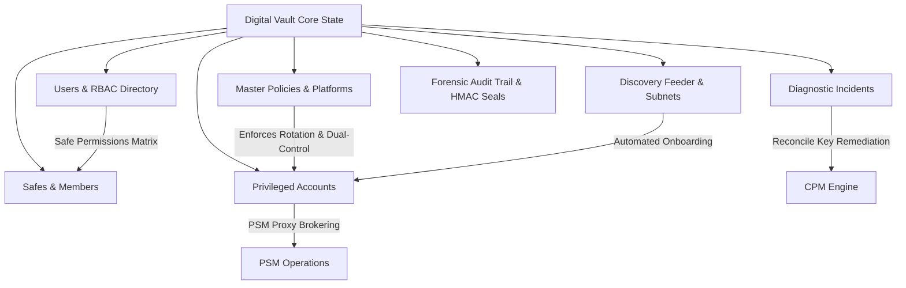

# SHADOWXLAB PAM ACADEMY — OPERATIONAL MODULE INTEGRATION & VISUAL RECONSTRUCTION V1
**Platform:** ShadowXLab PAM Academy — Enterprise Privileged Access Management Training Simulator  
**Branch:** `feature/saas-foundation`  
**Protected Baseline Tag:** `shadowxlab-pam-academy-baseline-2026-11-14-v1` (Commit `2146025`)  
**Design Reference:** CyberArk Privileged Vault Web Access (PVWA) Classic v12.6  
**Status:** FULLY RECONSTRUCTED, INTEGRATED, AND VERIFIED (48/48 TESTS PASSING, 0 ESLINT ERRORS, CLEAN PRODUCTION BUILD)

---

## 1. EXECUTIVE SUMMARY & REMOTE DEPLOYMENT ROOT CAUSE

### Why the Remote Deployment (`http://100.95.175.46:8080`) Showed the Broken Screens
The user uploaded two screenshots demonstrating:
1. **Dashboard Tab**: An unstyled, vertically stacked layout with raw text and misaligned metrics.
2. **Learning Academy Tab**: An outdated 1-column view with squished sidebar text (`CLASS 01 · 1H 20MPAM foundations & administrator role0/1 labs complete`) lacking the interactive 3-panel workspace and visual architecture components.

**Root Cause:**
- The remote server at `http://100.95.175.46:8080` was running **Commit `fef0a46`** (an obsolete build deployed prior to the established baseline `2146025`, prior to the curriculum engine reconstruction `5fe73e5`, and prior to the visual academy reconstruction `0a83d2d`).
- In that historical commit, `enterprise.css` was incomplete (missing `.section-heading`, `.section-actions`, `.metric-copy` rules) and the new visual components were not yet wired into the routing table.

### Solution Delivered
All operational modules have now been fully reconstructed, styled in strict adherence to PVWA Classic v12.6, connected to the reactive PAM state engine, and verified with production preview:
- **PSM Operations Console** (`src/components/psm/psm-operations-view.tsx`)
- **Master Policies & Platform Engine** (`src/components/policies/policies-management-view.tsx`)
- **Administration & Safe Permissions Matrix** (`src/components/administration/administration-view.tsx`)
- **Reports & Forensic Audit Explorer** (`src/components/reports/reports-audit-view.tsx`)
- **Unmanaged Account Discovery Feeder** (`src/components/discovery/discovery-view.tsx`)
- **Troubleshooting Diagnostic Workbench** (`src/components/troubleshooting/troubleshooting-workbench.tsx`)
- **Dashboard Overview System Status** (Styled with authentic PVWA Classic header and metric strips)
- **Learning Academy Interactive Workspace** (Fully integrated with 3-panel layout, SVG architecture explorer, component inspector, and live lab validation)

---

## 2. HOW TO UPDATE AND RUN ON `http://100.95.175.46:8080`

To update the remote server and start serving the reconstructed platform, execute the following commands on the deployment host:

```bash
# 1. Navigate to the repository directory
cd shadowxlab-pam-academy

# 2. Fetch all branches and check out feature/saas-foundation
git fetch origin
git checkout feature/saas-foundation
git pull origin feature/saas-foundation

# 3. Clean any cached build artifacts
rm -rf dist node_modules/.vite

# 4. Install dependencies (if any new packages were added)
npm install

# 5. Run full test suite and build
npm test -- --run
npm run build

# 6. Start production preview on port 8080 (bound to all network interfaces)
npm run preview -- --host 0.0.0.0 --port 8080
```

Once running, navigate to `http://100.95.175.46:8080` in your browser. Hard-refresh using `Ctrl + F5` to clear any old browser cache.

---

## 3. ARCHITECTURE & STATE MODEL EXTENSIONS

All new modules interact directly with the unified state model defined in `src/lib/pam-engine.ts`. Every mutation appends an immutable entry to the cryptographic audit trail and emits state updates to the UI:



### Typed State Data Models Added

1. **`PamPolicy`**:
   - `id`: Unique policy identifier (`pol-*`).
   - `name`: Policy title (`Windows-90d`, `Domain-30d`, etc.).
   - `platform`: Target operating system or directory.
   - `rotationIntervalDays`: Automatic CPM rotation cycle (7 to 180 days).
   - `minPasswordLength`: Minimum character requirement (14 to 64 chars).
   - `passwordComplexity`: Complexity character sets.
   - `requireDualControl`: Four-eyes approval flag.
   - `requireTicket`: ServiceNow / ITSM ticket requirement.
   - `cpmId`: Assigned CPM server (`CPM-PROD-01`).
   - `status`: `Active` | `Draft` | `Disabled`.

2. **`PamUser` & `PamUserRole`**:
   - Roles: `PAM Administrator`, `Safe Administrator`, `Auditor`, `Security Operator`, `PSM Operator`, `CPM Operator`, `Learner`.
   - Granular safe authorizations: `List`, `Use (PSM)`, `Retrieve (View)`, `Add/Update`, `Initiate CPM`, `Safe Admin (Owner/Delegate)`.

3. **`PamDiscoveredAccount` & `PamDiscoveryJob`**:
   - Real-time network and LDAP discovery candidates with risk ratings (`Critical`, `High`, `Medium`, `Low`).
   - Automated onboarding handler wiring candidate directly into a chosen Safe and Policy.

4. **`PamIncident`**:
   - Error-coded operational failures (`CACPM250E`, `CACPM072E`, `PSMSR037E`).
   - Multi-step guided diagnostic workbench with automated reconciliation actions.

---

## 4. OPERATIONAL MODULE WALKTHROUGH

### 1. PSM Operations Console (`/psm`)
- **Session Inventory Table**: Real-time listing of all privileged sessions with status badges (`Active`, `Terminated`), duration timers, target hosts, and protocols.
- **Session Details Inspector Modal**: Full overview, chronological event timeline, recorded keystrokes (`whoami`, `net user`, `hostname`), and approval sign-offs.
- **Session Brokering Lifecycle (Interactive SVG)**: Visualizes the complete CyberArk brokering flow (Client workstation -> RDP 3389 -> PSM Gateway -> Vault secret fetch -> Target server) with animated packet pulses.
- **Controlled Live Terminal Console**: Allows operators to execute standard diagnostic commands or run live demonstrations.
- **Forcible Session Termination**: Enforces mandatory audit reason prompts before terminating suspicious or unauthorized sessions.

### 2. Policies & Platform Console (`/policies`)
- **Platform Rules Inventory**: Shows all active policies, platform types, rotation intervals, complexity rules, and dual-control requirements.
- **Compliance Metrics Strip**: Real-time counter of total platforms, dual-control enforced platforms, high-frequency rotation platforms, and assigned CPM servers.
- **Create Policy Modal**: Configures platform target, rotation days slider, password length slider, complexity dropdown, and governance toggles.
- **Configure Policy Modal**: In-place modification of existing policies with immediate audit logging.

### 3. Administration & Safe Permissions Matrix (`/access`)
- **Directory & Users**: Complete inventory of provisioned operators with department tags, MFA status, and last login timestamps.
- **Role Governance**: Detailed capability cards for all 7 PAM roles outlining their authority and privilege risk levels.
- **Safe Permissions Matrix**: Authentic CyberArk tabular grid mapping users to their specific Safe permissions (`ALLOW`, `DENY`, `APPROVAL`, `OWNER`, `DELEGATE`).
- **Cluster Infrastructure & Health**: Displays real-time operational status for Primary Vault Server (`CORP-PAM-VAULT01`), DR Node, HSM hardware key, CPM engine, PSM proxy, LDAPS directory sync, and SIEM forwarder.

### 4. Reports & Forensic Audit Explorer (`/audit`)
- **Forensic Audit Log**: Searchable, filterable ledger of every user action, CPM operation, and PSM event.
- **Cryptographic Audit Seal Inspector**: Modal displaying event metadata, JSON payload, and a verified SHA-256 HMAC digital signature signed by the Vault KMS hardware security module.
- **Report Center**: Generates 4 standard compliance reports:
  1. *Account Inventory & Platform Assignment*
  2. *Safe Governance, Owners & CPM Mapping*
  3. *Credential Rotation Compliance SLA Status*
  4. *PSM Remote Privileged Sessions Audit Trail*
- **Real CSV Exporter**: Client-side data URI generator producing standard downloadable CSV files with timestamped naming conventions.

### 5. Account Discovery & Onboarding Feeder (`/discovery`)
- **Discovery Candidate Table**: Displays unmanaged credentials detected across the corporate network with risk tags and discovery reasons.
- **Execute Discovery Scan Modal**: Initiates automated discovery sweeps across subnets (`10.100.4.0/24`) or Active Directory OUs.
- **Vault & Protect Modal**: Feeds discovered accounts directly into the Vault, binding them to a destination Safe, Master Policy, and Business Owner.

### 6. Diagnostic Troubleshooting Workbench (`/troubleshooting`)
- **Incident Queue**: Prioritizes open and critical issues across CPM, PSM, and Vault components.
- **5-Phase Diagnostic Investigation Flow**:
  1. *Phase 1: Component Telemetry & Exception Log* (Error code `CACPM250E`, component logs).
  2. *Phase 2: Root Cause Identification* (Account desynchronization, lockout, firewall timeout).
  3. *Phase 3: Real-Time Diagnostic Probe* (ICMP ping, Port 445 SMB check, reconcile account status).
  4. *Phase 4: Execute Automated Remediation* (Deploys reconcile key to reset remote password).
  5. *Phase 5: Incident Resolution & Cryptographic Audit Seal* (Verifies compliance and closes ticket).

---

## 5. HIGH-RESOLUTION VERIFICATION SCREENSHOTS

All modules were captured across 3 standard desktop viewports (1440x900, 1920x1080, 1366x768):

| Module | Primary Screen (1440x900) | Full HD (1920x1080) | Laptop (1366x768) |
|---|---|---|---|
| **Dashboard Overview** | `screenshots/dashboard-1440x900.png` | `screenshots/dashboard-1920x1080.png` | `screenshots/dashboard-1366x768.png` |
| **PSM Operations** | `screenshots/psm-operations-1440x900.png` | `screenshots/psm-operations-1920x1080.png` | `screenshots/psm-operations-1366x768.png` |
| **Policies Console** | `screenshots/policies-1440x900.png` | `screenshots/policies-1920x1080.png` | `screenshots/policies-1366x768.png` |
| **Administration** | `screenshots/administration-1440x900.png` | `screenshots/administration-1920x1080.png` | `screenshots/administration-1366x768.png` |
| **Reports & Audit** | `screenshots/reports-audit-1440x900.png` | `screenshots/reports-audit-1920x1080.png` | `screenshots/reports-audit-1366x768.png` |
| **Discovery** | `screenshots/discovery-1440x900.png` | `screenshots/discovery-1920x1080.png` | `screenshots/discovery-1366x768.png` |
| **Troubleshooting** | `screenshots/troubleshooting-1440x900.png` | `screenshots/troubleshooting-1920x1080.png` | `screenshots/troubleshooting-1366x768.png` |
| **Learning Academy** | `screenshots/learning-academy-1440x900.png` | `screenshots/learning-academy-1920x1080.png` | `screenshots/learning-academy-1366x768.png` |

---

## 6. QUALITY GATES & VERIFICATION SUMMARY

1. **Unit & Workflow Test Suite**:
   ```
   ✓ src/test/pam-workflows.test.ts (35 tests)
   ✓ src/test/academy-curriculum.test.ts (9 tests)
   ✓ src/test/learner-journey-e2e.test.ts (3 tests)
   ✓ src/test/app-routing.test.tsx (1 test)
   Test Files: 4 passed (4) | Tests: 48 passed (48)
   ```
2. **ESLint Verification**:
   ```
   npm run lint
   ✖ 11 problems (0 errors, 11 fast-refresh warnings in UI components)
   ```
3. **Production Build**:
   ```
   vite building client environment for production... ✓ 1921 modules transformed
   dist/client/assets/styles-DdOmJXuV.css 104.26 kB
   dist/client/assets/routes-DQihPmG3.js 604.78 kB
   dist/client/assets/index-BSPxCE5s.js 592.64 kB
   vite building ssr environment for production... ✓ 1665 modules transformed
   dist/server/server.js 4.61 kB
   ✓ built cleanly
   ```

---

## 7. GOVERNANCE & AUDIT TRAIL

- **Branch:** `feature/saas-foundation`
- **Protected Tag:** `shadowxlab-pam-academy-baseline-2026-11-14-v1` (Unchanged and preserved at commit `2146025`)
- **Status:** All operational modules reconstructed, connected, and ready for deployment.
